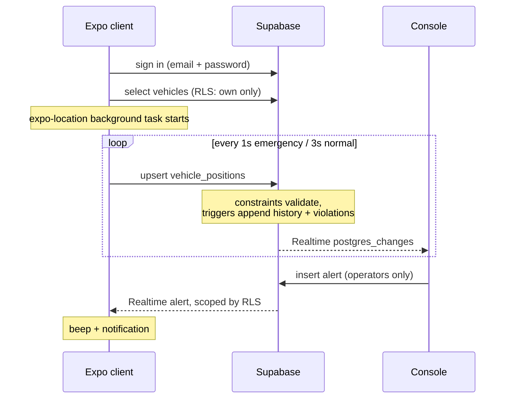

# SUTRA — Real-Time Vehicle Telemetry

A driver's phone streams live GPS to Supabase. An operator watches the fleet on
a map, sends alerts, and reviews where and when rules were broken.

| Component | What it is | Status |
| --- | --- | --- |
| `mobile/` | Expo (React Native) vehicle client | current |
| `admin-dashboard/` | Operator + driver console, vanilla JS | current |
| `supabase/` | Postgres schema, RLS, Edge Functions, tests | current |

The original Kotlin client (`apk/`) and Node WebSocket relay (`backend-mock/`)
were removed once the Expo app and Supabase replaced them. They remain in git
history if ever needed.

**Live**

- Dashboard — https://sutra-control--l1iydflj3v.expo.app
- Supabase project — `ytqpjxpzhgintwpbujcy`
- Android APK — built via EAS, see *Setup*

---

## How it works



One account works in both the app and the dashboard. Role is decided by data,
not by a separate login.

---

## Roles

| | Operator | Driver |
| --- | --- | --- |
| Fleet map and list | every vehicle | own vehicles |
| Drive history and violations | every vehicle | own vehicles |
| Send alerts | yes | no |
| Green corridor | watch all | open one, only if authorized |

An operator is a row in `operators`. Nobody can self-promote: the table has no
insert policy. Access is granted by adding an address to `operator_invites`,
which a trigger honours on signup.

The console is deliberately **one interface for both roles**. Scope is enforced
by row-level security rather than by hiding things in the browser, so an
operator's list contains every vehicle because the database returns every
vehicle.

---

## Security model

Emergency privilege is a database column an administrator sets. It is **not**
something a driver can claim.

- `vehicles.is_emergency_authorized` is protected by a `BEFORE UPDATE` trigger,
  because Postgres has no column-level RLS on `UPDATE`. A driver attempting to
  set it gets `P0001`. An administrator still can: the check is on
  `current_user`, not on the `role` setting, which would have made the privilege
  ungrantable.
- `vehicle_positions` has **no emergency column at all**. Status is derived by
  joining to `vehicles`, so a modified client has nothing to forge.
- Range checks on latitude, longitude, speed and heading are database
  constraints, not application code.
- History and violations are written by triggers, so they cannot be skipped by a
  modified client.
- Alerts are readable only by their addressee or as a broadcast. Only operators
  can send, and only under their own identity.

Authorize a vehicle:

```sql
update public.vehicles
   set is_emergency_authorized = true
 where vehicle_number = 'KA-03-AB-1234';
```

Grant operator access:

```sql
insert into public.operator_invites (email, note)
values ('ops@example.com', 'Control room');

select public.sync_operator_invites();  -- if the account already exists
```

---

## Alerts that make a sound

Every new alert beeps (a bundled three-pulse tone), vibrates and posts a
max-importance notification on its own Android channel. Nothing needs a tap:
a driver should never have to touch the phone to hear a warning.

Alerts come from three places:

| Source | Category | When |
| --- | --- | --- |
| An operator on the dashboard | CONGESTION, HAZARD, RULE, MESSAGE | on demand |
| The database, on a speeding episode | RULE, "Overspeeding: 95 km/h in a 80 km/h zone" | once per episode |
| A green corridor | EMERGENCY, "Emergency vehicle ... give way" | once per vehicle per corridor |

Alerts ride Supabase Realtime while the app is running, and are **also pushed**,
so they reach a phone whose app has been closed:

```
alert inserted → trigger → pg_net → notify Edge Function → Expo → FCM → phone
```

`notify` takes only an alert id and trusts nothing else in the request. It
calls `claim_alert_push`, which stamps `alerts.pushed_at` and returns the
recipients, so a replayed or duplicated call sends nothing. An addressed alert
goes to the phone currently driving that vehicle (`device_tokens.vehicle_id`),
a broadcast to every registered phone, and an expired one to nobody: a give-way
warning that arrives after the ambulance has passed is wrong, not just late.
Each push's time-to-live is the alert's remaining life for the same reason.

Push is sent even to phones that are open, because Realtime has been seen to
die silently. The phone collapses the two into one: both carry the identifier
`sutra-alert-<id>`, which on Android is the notification's tag, so the second
replaces the first in the tray; and the app silences a push for an alert it has
already sounded.

**Push needs Firebase, which is set up outside the code.** Until it is, the app
builds and behaves exactly as before - alerts over Realtime while it runs - and
registration logs why it could not get a token:

1. Create a Firebase project and add an Android app with package
   `com.sutra.vehicle`. Download `google-services.json` into `mobile/`. It holds
   public identifiers and may be committed; `app.config.ts` picks it up
   automatically when present.
2. In Firebase, *Project settings → Service accounts → Generate new private
   key*. Upload that JSON to EAS (*expo.dev → Credentials → Android → FCM V1
   service account key*). **It is a private credential: never commit it.**
   `.gitignore` blocks the usual file names.
3. Rebuild the APK.

---

## Green corridor

An emergency vehicle an operator has authorized picks a destination and opens a
corridor. What is real and what is not is stated everywhere it is shown,
because this is meant to be put in front of traffic authorities:

| Part | Status |
| --- | --- |
| Fastest route (OSRM), drawn in green | real |
| SUTRA drivers ahead on the route warned to give way, with a beep | real |
| The actual junctions on the route (OpenStreetMap `highway=traffic_signals`) | real |
| Those junctions turning amber, then green, as the vehicle approaches | **simulated** |

SUTRA does not and cannot legally control traffic lights. The simulated states
show what integrating with a city's adaptive signal control would do.

All the per-frame work happens in one Postgres trigger on
`vehicle_positions`, so it keeps working when the ambulance's app is in the
background. On each position it finds the vehicle's progress along the stored
route, advances junction states (pre-empt within 500 m, green within 200 m,
passed once cleared), warns vehicles within 150 m of the route in the next
1.5 km, and ends the corridor on arrival. Corridors also lapse after an hour.

Design: `docs/superpowers/specs/2026-09-22-green-corridor-design.md`.

Limits worth saying out loud in a pitch: OSRM's "fastest" uses speed limits,
not live traffic; only drivers running SUTRA are warned; the public Overpass
servers that supply junctions are often busy, so the lookup is retried from
the phone and a corridor starts without junctions if both fail.

---

## Data model

| Table | Purpose |
| --- | --- |
| `vehicles` | One row per vehicle, owned by a driver |
| `vehicle_positions` | Live position, one upserted row per vehicle |
| `position_history` | Append-only track, written by trigger |
| `violations` | Speeding episodes with where, when and peak speed |
| `alerts`, `alert_receipts` | Operator and system alerts, and acknowledgements |
| `corridors`, `corridor_route_points`, `corridor_signals`, `corridor_warnings` | Green corridors: route, simulated junction states, drivers warned |
| `operators`, `operator_invites` | Who may watch the whole fleet |
| `device_tokens` | Which phone is in which vehicle, for push |
| `events` | Everything that happens to a vehicle, in a fixed set of kinds |
| `zones`, `zone_presence` | Operator-drawn areas, and who is inside them |
| `road_segments` | OpenStreetMap roads: direction, one-way, posted limit |
| *(function)* `nearby_vehicles()` | What a driver may see around them, with identities stripped |
| `settings` | Speed limit, shared by trigger and clients |
| `retention_policy` | Prune windows, as data rather than code |

Violations are recorded as **episodes**, not per frame: one row per period above
the limit, keeping the worst speed, closed on dropping 5 km/h under it so
hovering at the limit does not churn.

Retention runs nightly via `pg_cron`. Open violations are exempt, since an old
row for a vehicle speeding right now is not stale data.

---

## No API keys for maps

| Layer | Provider | Key required |
| --- | --- | --- |
| Map rendering | MapLibre GL | none |
| Tiles | OpenFreeMap (OpenStreetMap data) | none |
| Routing | OSRM | none |
| Geocoding | Nominatim | none |
| Nearest hospital / fire / police | Overpass (OpenStreetMap) | none |
| Traffic signals | Overpass (OpenStreetMap) | none |

Routing and geocoding go through Edge Functions rather than being called
directly, so a provider can be swapped by redeploying a function instead of
shipping a new app. The public OSRM and Nominatim endpoints are free but
intended for light use; point `ROUTER_URL` and `GEOCODER_URL` at your own
instances before depending on them.

---

## Setup

### 1. Configuration

```bash
cp mobile/.env.example               mobile/.env
cp admin-dashboard/config.example.js admin-dashboard/config.js
```

Both need only a Supabase URL and anon key. The anon key is publishable by
design and constrained by RLS; a `service_role` key must never appear in either.

The mobile app also carries these in `app.config.ts` `extra`, so a build cannot
ship without them. Environment variables still take precedence when set.

### 2. Database

```bash
npx supabase link --project-ref <ref>
npx supabase db push
npx supabase functions deploy directions
npx supabase functions deploy geocode
npx supabase functions deploy corridor
npx supabase functions deploy nearby
npx supabase functions deploy notify
```

Push also needs two Vault secrets the alerts trigger reads, so migrations stay
free of project-specific values:

```sql
select vault.create_secret('https://<ref>.supabase.co', 'sutra_project_url');
select vault.create_secret('<anon key>', 'sutra_push_key');
```

### 3. Dashboard

```bash
cd admin-dashboard && python -m http.server 8080
```

Deploy with `cd mobile && npx eas deploy --export-dir dashboard-dist`.

Supabase needs to know where auth emails may return to. In
**Authentication → URL Configuration**, set the site URL to
`https://sutra-control.expo.app/confirmed.html` and add
`https://sutra-control.expo.app/**` under redirect URLs. Left at the default,
confirmation emails link to `localhost:3000`, a dead page on a phone - the
email is still confirmed, but it looks like a failure. The dashboard derives its own
redirect from `window.location.origin`, so it follows wherever it is served -
but Supabase will only honour an address on that list.

Only the deployed URL is currently listed. A password reset started from a
locally served copy therefore lands on the deployed dashboard rather than
`localhost`. That still completes the reset; add `http://localhost:8080` to the
list if you would rather it come back to the local copy.

### 4. Android app

```bash
cd mobile
npm install
npm run build:apk        # EAS cloud build, all four ABIs
```

EAS is the recommended path. A local build works but needs the Android SDK and
enough free RAM:

```bash
npm run prebuild         # expo prebuild, then reapply Gradle memory tuning
npm run apk              # gradlew assembleDebug with ninja parallelism capped
```

---

## Testing

```bash
cd mobile         && npm test && npm run typecheck   # 201 tests
cd supabase/tests && npm install && npm test         # 382 tests
```

Schema and RLS tests run against **PGlite** — Postgres compiled to WASM, in
process — so no Docker and no hosted database are needed. The `auth` schema is a
stub matching Supabase's shape, so these verify policy logic rather than
Supabase's own runtime; `db push` is where that gets confirmed.

The runner is pinned to `--test-concurrency=1`: each test boots its own WASM
Postgres, and running files in parallel exhausts memory.

---

## Emergency destinations

One tap routes to the nearest hospital, fire station or police station. These
are looked up around the driver in OpenStreetMap, not stored: they were three
fixed Bengaluru coordinates until a driver in Delhi tapped one and got a
2,000 km route.

The search widens through 5, 15 and 40 km until something is found, so a rural
road still gets an answer. If no location fix has arrived yet the chips are
disabled and routing refuses - a guessed origin is what made the wrong route
look like a working one.

## Around me

A driver-centred view of the SUTRA vehicles nearby: the driver fixed at the
centre pointing up, others placed by distance and by how many degrees off the
nose. A toggle swaps the radar for the same vehicles on the map.

Tesla does this with cameras on the car, which see all traffic. A phone cannot,
so this is the connected-vehicle version - and the screen says so, the same way
the corridor labels its signals simulated.

Realtime cannot serve it: a driver may select only their own `vehicle_positions`
row, and Realtime delivers only rows the subscriber may select, so a
subscription returns their own vehicle and nothing else. Widening that policy
would hand every signed-in account the live position of the whole fleet.
Instead `nearby_vehicles()` runs as the owner and returns position, speed,
heading, type and a `warned` flag under an **opaque per-caller reference** -
never a plate, a driver name or a vehicle id. Two drivers cannot compare
references to re-identify anyone.

Positions arrive every one to three seconds. Each vehicle is carried forward
along its own heading and speed in between, and stops being guessed after six
seconds, because a car that braked or turned would otherwise sail on through a
wall.

## A simulated fleet

Step-by-step instructions, every option, and a recorded test run are in
[`tools/README.md`](tools/README.md).

`tools/` runs vehicles that behave like phones, so the system can be shown
without one device per vehicle:

```bash
cd tools && npm install
copy .env.example .env    # then put your login in tools/.env
node simulate.mjs --count 5 --speeder --for 120
```

They centre on wherever your own vehicle last reported, so simulated traffic
appears around the real phone. Pass `--near lat,lng` to put them somewhere
else, and `--speeder` to make one exceed the limit, which is the quickest way
to see an automatic violation alert arrive on a real device.

Nothing here is a shortcut: each one registers a real vehicle and upserts
through the same client the app uses, so the triggers, violations, corridor
warnings and the surroundings view all see it - none of them can tell the
difference, and row-level security applies exactly as it would to a driver.
Plates all begin `SIM `. `--for` stops and removes them by itself; otherwise
Ctrl-C does. `--cleanup` removes leftovers from an interrupted run. Removal goes
through `remove_simulated_vehicles()`, which lets an operator delete only their
own simulated vehicles: vehicles have no delete policy, because deleting one
would erase its violations.

## Trips and replay

`vehicle_trips()` groups `position_history` into journeys, built from **moving
points only** (above walking pace), split where movement stops for more than
five minutes. Summing every recorded point would count a parked phone's GPS
wobble as distance: an hour parked became kilometres "driven". It runs as the
caller, so row-level security decides whose trips come back.

The console's Insights lists a vehicle's trips; any of them replays on the map
with a moving marker, the speed at each moment, and a pin wherever a rule was
broken. *Speeding map* draws a heatmap of the last 30 days weighted by how far
over the limit. Drivers see their own week under *Trips and history*.

## Collision warnings

When two vehicles are heading for the same point, both are warned a few
seconds ahead and told which side the other is coming from. It is closest
point of approach on current speed and heading, limited on purpose to paths
crossing at 30-150 degrees: phone GPS is good to 5-10 m and lanes are 3.5 m
apart, so a plain proximity test fires on every oncoming car and overtake.
Braking drivers, parked vehicles and stale positions are skipped. Thresholds
(`conflict_*`) are rows in `settings`, tunable without a deploy.

## Harsh braking and wrong way

Harsh braking (`harsh_brake_mps2`, 0.4 g by default) is the speed drop between
two fixes; it is recorded but never announced, because beeping at someone just
after an emergency stop distracts them at the worst moment.

Wrong way needs to know which roads are one-way. Load OpenStreetMap roads for
each area you operate in:

```bash
cd tools && node import-roads.mjs --near 28.6241,77.4356 --radius 3000
```

It runs from a laptop because the public Overpass servers refuse Supabase's
runtime. Three fixes in a row against a one-way road, above 10 km/h, with no
road nearby the vehicle may legally be on (the far side of a dual carriageway
is often within GPS error), flags it and alerts the driver. Areas without
imported roads are simply not checked.

Every one of these checks runs inside the phone's position update, so each
logs and lets the position through if it ever fails.

## Speed limits by place

`speed_limit_at()` gives the limit where a vehicle is, in order: a zone with a
limit (the strictest, where zones overlap), the limit posted on the road it is
on (`road_segments.maxspeed_kmh`), a default for that kind of road from
`road_class_limits`, then the global `speed_limit_kmh` setting. The road it is
on is the nearest imported segment running the way it is travelling, so a
service lane is not held to the highway beside it. `road_class_limits` starts
empty on purpose: limits are set by state notification and vary by vehicle
class, so an operator fills in what applies:

```sql
insert into public.road_class_limits (highway, limit_kmh, note)
values ('residential', 30, 'State notification, 2024');
```

## Signal adapter

The interface for connecting a city's traffic-signal controller is
[`docs/signal-adapter.md`](docs/signal-adapter.md). Every junction change on a
corridor is recorded in `signal_commands` as the request SUTRA would make;
in the default `simulation` mode nothing is sent. `tools/mock-signal-adapter.mjs`
is a reference implementation of the city's side. Corridors whose vehicle has
been silent for two minutes, or that are past their hour, are ended every
minute by `end_stale_corridors()`, which releases any junction still held.

## Without signal

A position that fails to get through for want of a network is kept on the
phone (`src/offlineBuffer.ts`, in AsyncStorage) and sent once a live position
succeeds again, oldest first, through `record_buffered_positions()`. It goes
into `position_history` only - never `vehicle_positions` - because replaying
old fixes as live ones would move the vehicle backwards on every map and run
every safety check on stale data. Trips and replay include the stretch without
signal; speeding is not judged on late, phone-timestamped points.

## Zones and events

Operators draw zones on the console's map (school, hospital, restricted,
depot). Entering or leaving one is recorded, and a zone can carry a message
sent to the driver on entry, which arrives by push like any alert. Leaving
takes two fixes outside, so GPS jitter on a boundary does not flap.

Everything that happens to a vehicle - zone crossings, speeding, harsh braking,
wrong way, collision warnings, corridor start and end - lands in one `events`
table, which the console's log reads live. Events are kept 30 days.

## Roadmap

`docs/roadmap.html`, and the same thing as `docs/SUTRA-roadmap.pdf`: the
remaining features as fourteen phases, ordered by dependency, with what each
one delivers and what it honestly cannot. Kept up to date alongside the record.

## Project record

`docs/project-record.html` is the running record of the project: what it is,
how it is built, what was done and when, and what is still open. Open it in a
browser. It is updated with every change to the project.

---

## Design

Dark, with a single acid-lime accent. The accent marks the live thing — the
route, the active nav item, the primary action — and nothing decorative uses it.

Icon, adaptive layers, splash and favicon are generated from code so the mark
stays editable:

```bash
cd mobile && npm run generate-assets
```

---

## Notes for whoever picks this up

Things that cost real time here and are worth knowing:

- **`legacy-peer-deps` is required** for Expo 57's `react-dom` version skew, but
  it silently skips missing peers. Three surfaced as build or runtime failures:
  `@react-native/jest-preset`, `test-renderer`, `expo-linking`. Run
  `npx expo export` before an EAS build; it catches this class in seconds rather
  than after a queue wait.
- **EAS environment variables did not reach the bundle**, despite existing, the
  profile declaring `environment: preview`, and `eas config` confirming they
  loaded. Two builds shipped broken before config moved into `app.config.ts`
  `extra`.
- **`org.gradle.workers.max` does not reach ninja.** Local native builds need
  `CMAKE_BUILD_PARALLEL_LEVEL`, which is what `npm run apk` sets. Without it,
  clang dies with `LLVM ERROR: out of memory` on a machine with little free RAM.
- **A Realtime channel that drops is not coming back on its own,** and the
  socket stays open looking healthy. The console now rejoins with backoff,
  hands Realtime each refreshed token (they expire hourly, after which rows are
  silently withheld), and re-reads positions every 15 seconds regardless.
  Treat Realtime as the fast path, never as the only one.
- **The `hidden` attribute is only `display: none` in the UA stylesheet.** Any
  author `display` rule beats it, which silently broke the dashboard's sign-in
  gate: login succeeded and the console rendered underneath it.
- **A throw in the background location task kills the app**, since it runs
  outside any React error boundary.
- **overpass-api.de answers 406 to generic library user agents** (curl,
  okhttp), and okhttp is what React Native's `fetch` sends on Android. Always
  send `Accept: application/json` and a real `User-Agent`. It also 406s, 504s
  or 429s the Edge Function unpredictably, hence the phone-side retry. On 15
  October the same query that returned 200 from an ordinary network was
  answered 406 by Overpass, 500 by its mirror and 403 by Nominatim when it came
  from the Edge runtime, so **every** OpenStreetMap lookup needs that retry,
  not just the corridor's junctions.
- **Android fixes a notification channel's sound on first creation.** Changing
  the beep means a new channel id (`sutra-alerts-v1` → `-v2`).
- **Functions in `public` are REST endpoints.** Postgres grants EXECUTE to
  PUBLIC by default, so every SECURITY DEFINER helper needs an explicit revoke
  (migration `000010`) unless clients are meant to call it.
- An early commit contained a Google Maps key. It has since been revoked - the
  key now returns `REQUEST_DENIED: The provided API key is invalid` - and the
  project no longer uses Google at all. The dead string remains in history,
  which is harmless and not worth rewriting published history to remove.

---

## Known limitations

- The mobile app has not been verified on a device by its author; it is
  validated by tests and as a build artifact.
- `position_history` grows at roughly 1,200–3,600 rows per vehicle-hour. The
  prune keeps 30 days.
- Public OSRM, Nominatim and Overpass endpoints carry no availability
  guarantee.
- Push receipts are not yet checked, so a delivery Expo accepted but FCM
  later dropped is not visible.
- Signal states are simulated until an authority connects a controller
  (`docs/signal-adapter.md`).
- Green-corridor signal states are simulated (see above).
